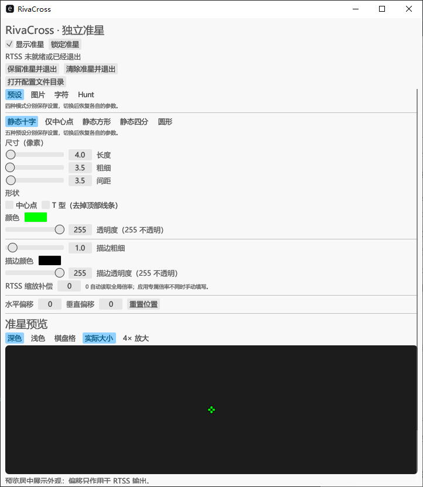
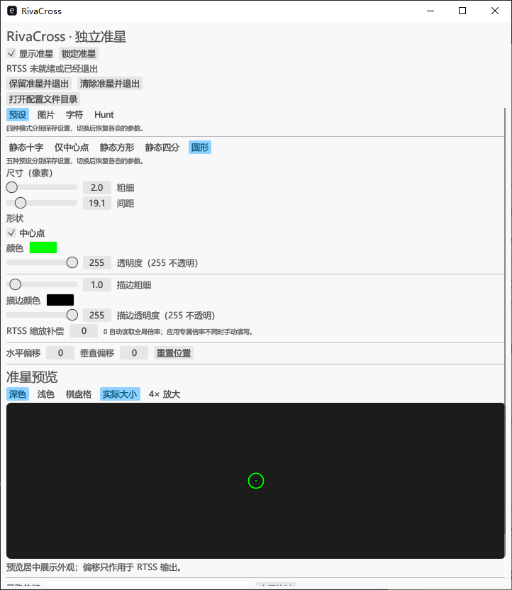
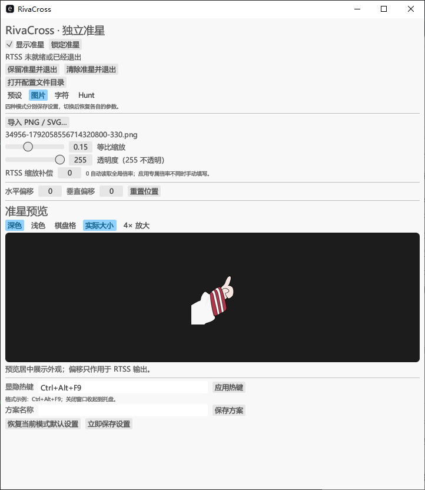
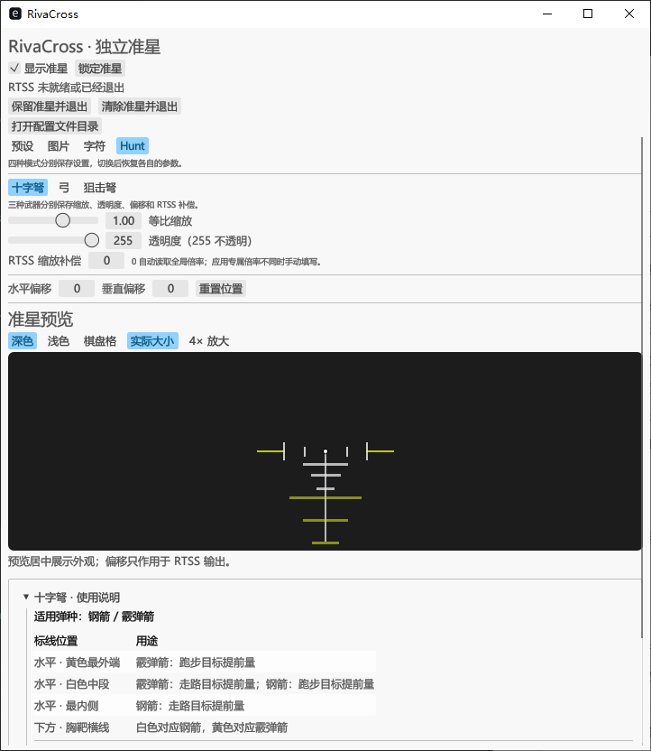

# RivaCross Rust

[English](README.md) | [简体中文](README_zh.md)

RivaCross Rust 是一款 Windows x64 轻量准星编辑器，使用 Rust 与 egui/eframe 构建，通过 RivaTuner Statistics Server（RTSS）显示自定义准星，注重减少后台资源占用。

当前为首次发布版 **0.1.0**。

灵感来自 [irseny/RivaCross](https://github.com/irseny/RivaCross)（[发布页](https://github.com/irseny/RivaCross/releases)）中通过 RTSS 显示准星的想法，本项目用 Rust 实现图形编辑界面。

## 轻量化设计

- 单 EXE 运行，无需安装器或 OverlayEditor 插件。Hunt SVG 素材编入程序，RTSS 需要单独运行。
- 原生桌面界面使用 Rust + egui/eframe 和 Glow 渲染后端，按需启用依赖功能。
- 界面按需刷新，内置 eframe 补丁避免隐藏窗口后事件循环持续空转。
- 锁定准星时，先完成待提交内容，再暂停连接检查、倍率查询和缓存清理，后台线程等待操作事件。
- 可以保留准星并退出编辑器，由 RTSS 继续显示。此时 RTSS 必须保持运行，图片缓存也需要保留。
- 发布构建启用 thin LTO 并剥离符号。实际体积、CPU 与内存占用取决于构建和使用场景。

## 功能

| 模式 | 可调整内容 |
| --- | --- |
| 预设 | 静态十字、仅中心点、静态方形、静态四分、圆形；对应尺寸、中心点、十字 T 型、颜色与独立描边透明度 |
| 图片 | 静态 PNG/SVG、透明背景、等比缩放；SVG 按目标尺寸重新渲染 |
| 字符 | 由 RTSS 直接绘制可打印 ASCII，可调颜色、透明度和大小 |
| Hunt | 内置十字弩、弓、狙击弩，附武器标线说明与素材来源 |

四种模式、五种预设和三种《猎杀：对决 1896》武器各自记忆参数。可以保存最多 100 个命名方案；应用方案或恢复默认时，只改动对应模式、形状或武器的设置。准星显隐和全局热键在所有模式间共用，热键可以修改。

图片与 Hunt 准星会围绕原画布中心对称裁去透明留白，保持瞄准点位置。RTSS 按区块输出，大画布超出目标窗口时仍保持居中，超出客户区的部分会被裁切。预览可切换实际大小与 4×。

## 界面截图

以下为 RTSS 未连接时的编辑器预览截图。

| 十字预设 | 圆形预设 |
| --- | --- |
| [](assets/screenshots/preset-cross.png) | [](assets/screenshots/preset-ring.png) |

| 导入图片 | Hunt 十字弩 |
| --- | --- |
| [](assets/screenshots/image-mode.png) | [](assets/screenshots/hunt-crossbow.png) |

## 快速开始

1. 启动 RTSS，启用 **On-Screen Display**，选择 **Raster3D** 渲染模式。本项目使用 RTSS 7.3.7 开发验证。
2. 运行本仓库发布包中的 `RivaCross.exe`，或按下文自行构建。当前编辑器界面为中文。
3. 选择模式并调整准星，停止编辑约 0.5 秒后自动保存。
4. 按 **Ctrl+Alt+F9** 显示／隐藏准星；若与其他程序冲突，可在界面修改热键。
5. 关闭窗口后，程序收起到托盘。左键双击托盘图标重新打开，右键菜单可切换显隐、锁定或退出。

调好后可以选择**锁定准星**。程序会先完成待提交内容，再禁用编辑和显隐热键。如果锁定期间 RTSS 重启、槽位重置或倍率变化，需要解锁后重新连接。每次启动程序时都处于未锁定状态。

| 退出方式 | 行为 |
| --- | --- |
| 保留准星并退出 | 保存配置并确认最新内容写入，保留自有槽位和图片缓存；提交失败时提示并保持编辑器运行。隐藏状态也会保留。 |
| 清除准星并退出 | 释放自有 RTSS 槽位后退出；界面中的 Ctrl+Q 使用此方式。 |

显隐热键只在编辑器运行时有效。RTSS 或 Windows 重启后，需要重新启动 RivaCross 恢复保留的准星。重复启动会打开已有编辑器窗口。

## 缩放与使用限制

- 将 **RTSS 缩放补偿设为 0** 可自动读取全局 OSD 倍率，读取失败时按 1× 处理。如果目标程序使用独立 RTSS 配置，请手动填写它的倍率。本程序不修改 RTSS 配置。
- PNG 放大使用最近邻采样；SVG 根据原始几何重新渲染。字符预览可能与 RTSS 外观不同，大字号仍受 RTSS 字体纹理分辨率限制。
- 可以导入不超过 32 MiB 的静态、自包含 PNG/SVG。解码后每边最多 4096 像素，总像素不超过 4,194,304；不支持动画和含外部资源的 SVG。SVG 可在分配像素前对称裁去大面积透明留白，有效绘制内容仍需符合尺寸限制。
- Hunt 缩放范围为 0.01–16.00，同时受图片尺寸限制。素材保留原色与半透明层，整体透明度按乘法叠加。狙击弩素材适用于 **16:10**，**16:9 尚未校准**。
- 字符模式支持 1–128 个可打印 ASCII，禁止 `<`、`>`、换行、中文和 Emoji。
- 叠加效果取决于 RTSS 与目标程序，具体游戏和分辨率的兼容性仍需实测。目前没有按游戏自动切换或开机启动功能。

## 配置与资源

数据保存在 `%LOCALAPPDATA%\RivaCross`。点击界面顶部或托盘菜单中的“打开配置文件目录”即可查看，锁定时也能使用。

| 路径 | 用途 |
| --- | --- |
| `config.json` | 版本 3 配置、模式／预设／武器独立参数、显隐、热键和方案，采用原子替换保存 |
| `resources/` | 导入的源图片副本，原文件移动后仍可使用 |
| `cache/` | 生成的 PNG 纹理；清理保留最新图片，用于重连与退出后显示 |
| `last-exit-error.txt` | 退出清理期间持续无法释放 RTSS 槽位时的诊断记录 |

没有配置文件时，程序使用默认设置。`config.json` 中的 `version: 3` 是内部配置格式编号，与软件发布版本号无关。配置无效时，编辑器会显示错误提示。若需重置，请先退出编辑器，备份并移走 `config.json`，再重新启动。

## 构建与验证

构建需要 Windows、Rust MSVC x64 工具链、MSVC Build Tools 和 Windows SDK，依赖版本以 `Cargo.lock` 为准。

```powershell
cargo run --locked
cargo fmt --all -- --check
cargo test --locked
cargo clippy --locked --all-targets --all-features -- -D warnings
cargo build --release --locked
```

发布构建生成 `target/release/rivacross.exe`，可重命名为 `RivaCross.exe`。发布时不启用仅供开发使用的 `ui-capture` feature。

RTSS 运行时，可以用 `cargo run --locked -- --inspect` 只读检查 RivaCross 的槽位，用 `cargo run --locked -- --query-zoom` 只读查询全局倍率。运行 `cargo run --locked -- --probe` 前请先退出编辑器，该命令会提交示例并释放槽位。默认忽略的 UI 和真实 RTSS 测试需要单独准备环境。

隐藏窗口事件循环的修复细节见 [eframe 补丁说明](vendor/README.md)。

## 灵感来源与致谢

- [irseny/RivaCross](https://github.com/irseny/RivaCross)（[发布页](https://github.com/irseny/RivaCross/releases)）提供了通过 RTSS 显示自定义准星的灵感，感谢 Irseny。
- RivaTuner Statistics Server 及其 SDK 提供叠加显示支持。
- 十字弩与弓素材来自 bilibili @Zuko819470293，编辑器内保留来源说明。
- 狙击弩参考素材来自 Steam Crosshair 创意工坊 [Hunt:showdown_crossbow_sniper_steel&slug_16:10](https://steamcommunity.com/sharedfiles/filedetails/?id=3316676875)。内置版本是含 19 个独立可编辑路径的矢量重绘版。
- 界面使用 egui/eframe，并包含本仓库已记录的事件循环补丁。

## 许可证

本项目自行编写的代码采用 [MIT License](LICENSE)。第三方依赖和素材分别遵循各自的版权与许可条款，不因本项目采用 MIT License 而改变。
